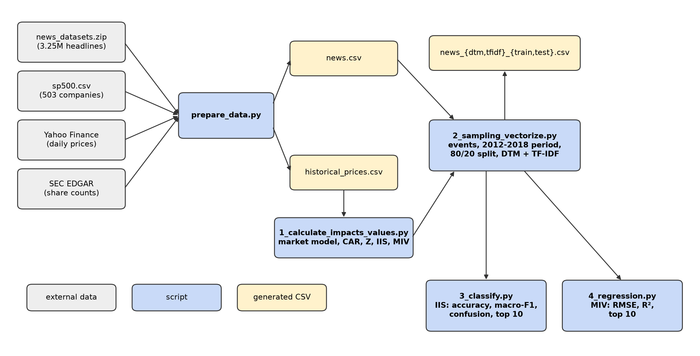
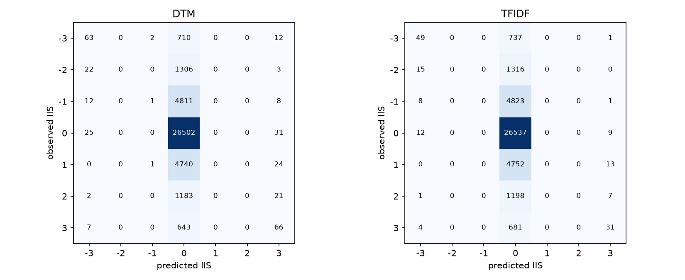

# NewsImpact: Financial Headlines and Abnormal Stock Returns

How much do financial headlines tell us about the market reaction that follows them? This project links 645,913 headlines about S&P 500 companies (2009–2020) to an event study of their stock returns. It then tests whether PyTorch models can predict the size and direction of the reaction from the headline text alone.



## What it measures

The unit of analysis is a **company-day news event**: all headlines about one company on one calendar day. For each event:

1. A **market model** (`R = α + β·R_S&P500`, fitted on trading days t−139 … t−20) gives the return the stock would have earned anyway.
2. The **cumulative abnormal return (CAR)** sums the unexplained part over the event day and the next two trading days.
3. Two prediction targets come from the CAR:
   - **Information Impact Score (IIS):** the CAR's z-score against the company's own history, binned into −3 … +3.
   - **Monetary Information Value (MIV):** the CAR × the pre-event market cap, in dollars.

A random seven-year window (seed 42 → 2012–2018) is split chronologically, 80/20, into 160,470 training and 40,195 test events. Leakage controls:
- the split falls on whole dates;
- the event window must fit inside its own partition;
- the vectorizers are fit on training text only.

The headlines become a document-term matrix (DTM) and TF-IDF vectors (1,000 uni/bigrams). Identical MLPs (1,000 → 256 → 64 → output) are trained on both representations.

## Results (test year 2018)

| IIS classification | Accuracy | Macro-F1 | AUC up / down / unusual |
|---|---:|---:|---|
| Majority class (IIS 0) | 66.07% | 0.114 | – |
| MLP, DTM | 66.26% | 0.155 | 0.582 / 0.582 / 0.591 |
| MLP, TF-IDF | 66.22% | 0.141 | 0.587 / 0.584 / 0.594 |

| MIV regression | RMSE | R² |
|---|---:|---:|
| Training mean | $1,774M | 0.000 |
| MLP, DTM | $1,760M | 0.016 |
| MLP, TF-IDF | $1,768M | 0.007 |

- **Accuracy hides the signal.** Both classifiers sit barely above always predicting "neutral", but their probabilities rank up, down and unusual reactions well above chance (AUC ≈ 0.58–0.59).
- **Extreme calls are informative.** The models only ever predict IIS −3, 0 or +3. Their rare extreme calls are right 40–55% of the time, against a 2% base rate.
- **Dollar impact is mostly about company size**, not headline content.
- **DTM and TF-IDF are indistinguishable**, and a logistic regression matches the MLPs. The limit is the information in the headlines, not model capacity.

These are associations, not forecasts. Some headlines report a price move that is already underway ("shares fall after …").



Full metrics, per-company tables (including the top 10 companies by test count, RMSE and R²) and the tuning grid are in [`results/model_comparison/`](results/model_comparison/). Data coverage and exclusion audits are in [`results/full_sample/`](results/full_sample/), and the term evidence for the text analysis is in [`results/text/`](results/text/).

## Running it

Requires Python 3.12.

```bash
python -m venv .venv && source .venv/bin/activate
pip install -r requirements.txt
```

Place the course's `news_datasets.zip` in `pipeline/datasets/`. The news data is not redistributed here. Then:

```bash
cd pipeline
export SEC_USER_AGENT="Your Name your@email"   # SEC EDGAR requires an identifying User-Agent
python prepare_data.py                # news.csv, historical_prices.csv  (~1 h first run; downloads are cached)
python 1_calculate_impacts_values.py  # event-study targets
python 2_sampling_vectorize.py        # 7-year sample, split, DTM/TF-IDF CSVs
python 3_classify.py                  # IIS classifiers → outputs/metrics, outputs/figures
python 4_regression.py                # MIV regressors
cd .. && python -m pytest -q          # 67 tests
```

The numbered scripts run without arguments. Results are deterministic (seed 42, CPU training). Prices and share counts are re-downloaded, though, and providers revise history, so a fresh download can shift numbers slightly. Our data was retrieved on 2026-10-18.

Optional scripts:

| Script | Purpose |
|---|---|
| `scripts/tune_models.py` | Re-derives the training settings on the validation tail, with inner-only vectorizers |
| `scripts/audit_full_sample.py` | Coverage, exclusion waterfall and market-cap jump review |
| `scripts/audit_ticker_identity.py` | Flags reused tickers |
| `scripts/term_evidence.py` | Evidence for the financially informative terms |
| `scripts/report_figures.py` | Pipeline and split figures |

## Repository layout

```text
pipeline/          the four numbered scripts, prepare_data.py and utils.py
                   (the course's starter folder; file names unchanged)
pipeline/datasets/ inputs: sp500.csv, ticker alias/exclusion lists, SEC CIK overrides, schema samples
scripts/           data-feasibility, audit, tuning and figure scripts
tests/             unit tests: event dates, event study, market cap, text, split, model loading
results/           aggregated metrics, figures and a few example headlines (no full datasets)
```

## Data and limitations

- **Universe:** today's S&P 500 is applied to 2009–2020, which introduces survivorship bias. 114 constituents have no headlines in the corpus.
- **Timestamps:** only about 4% of headlines carry a time of day. The rest are mapped by date.
- **Market cap:** estimated from SEC cover-page share counts × close price, falling back to Yahoo share counts and then a price-ratio estimate. The method is recorded per row.
- **Test period:** one year (2018), which was more volatile than the training years.

## License

The code is released under the [MIT License](LICENSE). The news data belongs to its original providers. Market data comes from Yahoo Finance and SEC EDGAR and is subject to their terms.
